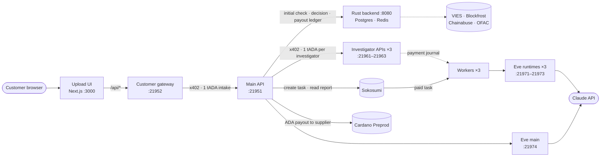

# Sniffer

Sniffer checks incoming e-invoices for payment fraud before a company pays them in crypto, and pays the supplier when the invoice is safe.
A customer submits an XRechnung/ZUGFeRD invoice (EN 16931 XML) whose payment address is a Cardano wallet. Sniffer scores it with deterministic rules, escalates unclear cases to three AI investigators, decides, and, if approved, pays the supplier in ADA.

It was built for the TUM Blockchain & AI Hackathon on [Masumi](https://www.masumi.network) / [Sokosumi](https://preprod.sokosumi.com). Every service-to-service payment uses [x402](https://www.x402.org) on Cardano. Everything runs on **Cardano Preprod with test ADA**.

## How it works

Two stages: a cheap software check runs on every invoice, and the expensive AI agent check runs only when the software check says **medium**.

```
 1. INTAKE         customer pays 1 tADA (x402) and sends the invoice XML to Main
                                        │
                                        ▼
 2. SOFTWARE CHECK Rust backend, deterministic rules, every invoice, seconds
                   XML validation, VIES, Blockfrost, Chainabuse, OFAC,
                   open orders, supplier history → risk score 0–100 → band
                                        │
           ┌────────────────────────────┼────────────────────────────┐
           ▼                            ▼                            ▼
       LOW (<20)                  MEDIUM (20–59)                 HIGH (≥60)
       approve + payout                 │                        reject
       no AI agents                     │                        no AI agents
                                        ▼
 3. AI AGENT CHECK only for MEDIUM; input = the software check result
                   3 investigators: invoice · wallet · supplier
                   each one a Sokosumi task paid via x402 (Claude via Eve)
                                        │
                                        ▼
 4. DECISION       Main LLM weighs the 3 reports; code guardrails win
                                        │
                          ┌─────────────┴─────────────┐
                          ▼                           ▼
                   approve + payout                reject
```

1. **Intake** (`main/`): Main verifies the customer's x402 payment and starts the case.
2. **Software check** (Initial Check, `backend/`, Rust): parses and validates the XML (Mustang), normalises it, and runs the criteria in `backend/config/criteria.json` against VIES, Blockfrost, Chainabuse, the OFAC sanctions list, open orders and supplier history. The result is a score and a band. Low and high cases are decided here, without any AI cost.
3. **AI agent check** (`investigator/`, medium cases only): one investigator per role, each given the software check result (including a matched open order). Main creates a Sokosumi task for each one and pays its x402 gate. The role's worker only starts a task that has a confirmed payment, asks its Claude runtime for a structured report, and completes the task.
4. **Decision** (`main/`): an LLM weighs the reports per `promts/main_agent_prompt.txt`. Code guardrails override it: a missing or `INSUFFICIENT_DATA` report means rejected/formal, and a `CRITICAL` report or `DONT_PAY` means rejected/risk.
5. **Payout** (`payout/`): a policy-gated ADA transfer to the invoice's payment address at a fixed `ADA_PER_EUR` rate, recorded in the backend's payout ledger.

**Safety rule**: no tADA leaves Sniffer's wallets for a case until the customer's intake payment is confirmed on chain. Payment journals are written before signing. A payment that failed before signing is retried up to 3 times; an uncertain payment stops the case for human inspection instead of retrying.

Measured on Preprod: a low-risk case reports "approved, payout submitted" about 12 s after the intake payment. A medium-risk case reaches its decision in about 3 min (three paid investigators). Details are in `docs/plans/PROGRESS.md`.

## Architecture

Who talks to whom, and where test ADA moves. All services run on one machine and listen on `127.0.0.1`.



- **Money:** the customer pays Main (intake); for a medium case Main pays each investigator; for an approved case the payout wallet pays the supplier. Every payment is journaled before signing.
- **Reports:** a worker starts a Sokosumi task only after its investigator API saw the payment, asks its Eve runtime (Claude) for a report and completes the task. Main reads the three reports from Sokosumi and asks Eve main for the decision.
- **State:** the backend keeps checks, invoices, supplier/wallet history and the payout ledger in Postgres. Main, the gateway and the investigators keep their case files and payment journals in `.local/`.

## Components

| Path | What it is | Default address |
|---|---|---|
| `backend/` | Rust backend: Initial Check, decisions, payout ledger, supplier history (Postgres + Redis) | `127.0.0.1:8080` (Docker) |
| `main/` | Main API: customer intake (x402), orchestration, decision, payout | `127.0.0.1:21951` |
| `investigator/` | Investigator x402 API, Sokosumi worker, Eve runtime launcher per role | APIs `21961–21963`, Eve `21971–21974` |
| `agent/`, `promts/` | Eve agent definition (Claude via `@ai-sdk/anthropic`) and the four role prompts | |
| `x402/` | x402 gate, idempotent payer, in-process facilitator, wallet CLI | |
| `payout/` | Supplier payout transfer (Evolution SDK) | |
| `scripts/` | `preflight` (read-only health check), `demo` (test customer), `sokosumi-login-win.mjs` (Windows login fix) | |
| `customer/` | Customer gateway for the upload frontend: pays the intake from the demo wallet, joins case view and fired criteria | `127.0.0.1:21952` |
| `frontend/` | Next.js upload UI (multi-file queue, live case progress, criteria with evidence), `/criteria` (all check criteria, read from `backend/config/criteria.json`), `/docs` (Swagger UI) | `127.0.0.1:3000` |
| `docs/` | Spec (`initial-check-spec.md`, German), plan and progress journal, x402 notes, OpenAPI specs, fixtures | |

API reference: `docs/openapi/` has OpenAPI 3.1 specs for the Main API, the backend, the investigator API and the customer gateway.

## Requirements

- Node.js 24 or newer, and npm
- Docker (it builds the Rust backend; a local Rust toolchain is needed only for backend development)
- [Sokosumi CLI](https://github.com/masumi-network/sokosumi/tree/main/apps/cli) `1.0.4` and a Sokosumi Preprod account
- An [Anthropic API key](https://console.anthropic.com) for Claude
- A [Blockfrost](https://blockfrost.io) project ID for Cardano **Preprod**
- Test ADA from the [Cardano faucet](https://docs.cardano.org/cardano-testnets/tools/faucet) (network: Preprod)

## Set up

### 1. Install

Quick path: `bun run setup` (or `bash scripts/setup.sh`) checks the requirements, installs packages, creates the config files, secrets and the service wallets, then asks for your API keys. Afterwards, continue with step 4 (Sokosumi). Before a demo, `bun run demo:setup` creates the test customer wallet and runs the preflight, which lists each wallet that needs test ADA. Both are safe to re-run. The manual steps follow.

```sh
git clone https://github.com/GineHyte/sniffer.git
cd sniffer
npm ci
npm install --global @masumi_network/sokosumi@1.0.4
mkdir -p .local && chmod 700 .local
```

### 2. Configure

Configuration lives in four files. None of them may be committed; `.env` and `.local/` are git-ignored.

| File | Contents |
|---|---|
| `.env` | `ANTHROPIC_API_KEY`, `BLOCKFROST_API_KEY_PREPROD`, `AGENT_AUTHOR` (template: `.env.example`) |
| `.local/sniffer-secrets.env` | Backend secrets: `SNIFFER_API_TOKEN`, `SNIFFER_HMAC_KEY`, `POSTGRES_PASSWORD` |
| `.local/payout.env` | `PAYOUT_MNEMONIC` of the supplier payout wallet |
| `.local/live.env` | Non-secret settings: wallet addresses, prices, URLs, Sokosumi IDs (template: `live.env.example`) |

```sh
cp .env.example .env && chmod 600 .env          # then fill in the keys
cp live.env.example .local/live.env              # addresses and IDs are filled in below

# Generated backend secrets (POSTGRES_PASSWORD must be URL-safe)
printf 'SNIFFER_API_TOKEN=%s\nSNIFFER_HMAC_KEY=%s\nPOSTGRES_PASSWORD=%s\n' \
  "$(openssl rand -hex 32)" "$(openssl rand -hex 32)" "$(openssl rand -hex 24)" > .local/sniffer-secrets.env
chmod 600 .local/sniffer-secrets.env
```

`ANTHROPIC_MODEL` defaults to `claude-opus-5-5`. If you choose another model, also set `MODEL_CONTEXT_WINDOW_TOKENS` to its context window.

### 3. Create and fund the wallets

The x402 wallets are created in `.local/x402/`. The CLI prints only addresses, never mnemonics.

```sh
for w in payer main-payer intake inv-invoice inv-wallet inv-supplier; do
  printf '%s: ' $w; node --env-file=.env x402/wallets.mjs create $w
done

# Supplier payout wallet: write a fresh 24-word mnemonic without printing it, then show its address
node --input-type=module -e "import {PrivateKey} from '@evolution-sdk/evolution'; import {writeFileSync} from 'node:fs'; writeFileSync('.local/payout.env','PAYOUT_MNEMONIC=\"'+PrivateKey.generateMnemonic(256)+'\"\n',{mode:0o600});"
node --env-file=.env payout/transfer.mjs address
```

- Put the `intake` address into `INTAKE_PAY_TO`, and the three `inv-*` addresses into `INVESTIGATOR_<ROLE>_PAY_TO` in `.local/live.env`.
- Fund `payer` (the test customer), `main-payer` (pays investigators) and the payout wallet from the faucet. About 10 tADA each covers several cases.
- Check a balance with `node --env-file=.env x402/wallets.mjs balance <name>`.

### 4. Set up Sokosumi

Read `sokosumi skills` first. Create your own resources; never reuse another project's IDs.

```sh
sokosumi --preprod auth login
sokosumi --preprod workspaces list --json                    # pick the organization Workspace
sokosumi --preprod vendors create --name "YOUR_VENDOR" --slug your-vendor --json
for r in invoice wallet supplier; do                          # one private Coworker per investigator
  sokosumi --preprod coworkers provision --vendor-id VENDOR_ID --name "Sniffer $r investigator" --capability tasks --json
done
sokosumi --preprod coworkers connect COWORKER_ID --vendor-id VENDOR_ID --workspace-id ORGANIZATION_ID --json   # per Coworker
```

- Continue only when `connect` reports `GRANTED`. `PENDING` means a Workspace owner or admin must approve it; then run `connect` again.
- Import each Coworker's runtime key straight into the OS keychain. The key is never printed:

  ```sh
  sokosumi --preprod coworkers api-key COWORKER_ID --json \
    | node -e 'let s="";process.stdin.on("data",d=>s+=d).on("end",()=>process.stdout.write(JSON.parse(s).apiKey.token))' \
    | sokosumi runtime key-import --coworker-id COWORKER_ID --api-key-stdin --json
  ```

- Fill `SOKOSUMI_ORGANIZATION_ID`, `SOKOSUMI_ORGANIZATION_SLUG` and `COWORKER_ID_<ROLE>` in `.local/live.env`.
- The OAuth login lasts about 2 hours. Main creates the investigator tasks with it, so log in again before long sessions.

### 5. Start the services

Each command runs in its own terminal, or in the background:

```sh
npm run stack                                        # Postgres, Redis, Rust backend (builds the image)
npm run investigator:eve -- invoice                  # repeat for: wallet, supplier, main
npm run investigator:api -- invoice                  # repeat for: wallet, supplier
npm run investigator:worker -- invoice               # repeat for: wallet, supplier
npm run main -- --confirm-live-payments              # pays with real Preprod tADA, hence the flag
```

Restart rules:
- after backend code or `backend/data/*` changes: `npm run stack`;
- after prompt changes in `promts/`: the Eve runtimes, which copy the prompts on start;
- after changes in `main/`, `x402/` or `payout/`: Main and the investigator APIs;
- after changes in `frontend/` when running the production build: `npm run build`, then restart `npm start`.

### 6. Check and run a test case

```sh
npm run preflight                                    # read-only; repeat until "Preflight passed."
npm run demo -- --confirm-live-payment               # pays 1 tADA intake, submits docs/fixtures/f1.xml, follows the case
```

The demo prints each status change with the elapsed time, then the decision, explorer links and a timing summary.

| Option | Effect |
|---|---|
| `--invoice-number N` | Submit as a new invoice. Resubmitting the same XML only resumes polling. |
| `--new-supplier` | Swap the seller for a fresh supplier from `backend/data/vies-mock.json` that has no history, so the case is medium and reaches the investigators. |
| `--fresh-wallet` | Create a new, never-used recipient address. The payout then lands in a wallet you control, and the address has no history. |
| `--case ID` | Follow an existing case without paying. |
| `--no-wait-confirm`, `--poll-ms` | Don't wait for the payout confirmation; change the poll interval (default 2 s). |

Example of a medium-risk run: `npm run demo -- --confirm-live-payment --new-supplier --fresh-wallet`.

### 7. Upload frontend

The browser talks only to the Next.js app; `/api/*` is forwarded to the customer gateway (`customer/api.mjs`), which pays
Main's intake with `payOnce` from the wallet `CUSTOMER_WALLET` (default `payer`). It shares the demo's payment journal
(`.local/demo`), so an XML paid by `npm run demo` or by the UI is never paid twice. Two terminals, with Main running:

```sh
npm run customer -- --confirm-live-payments          # pays INTAKE_PRICE_LOVELACE per new invoice, hence the flag
cd frontend && npm ci && npm run dev                 # http://localhost:3000
```

Production build of the UI (same gateway, same port): `cd frontend && npm run build && npm start`.
Check the mode before uploading: `curl http://127.0.0.1:21952/api/config` must show `"mode":"live"` for a paid run.

Drop one or more `.xml` files, check the preview, then click "Upload". The queue pays one invoice at a time. When Main
answers `503 too_many_unconfirmed_intakes`, the queue pauses for 20 s and retries the same invoice. Each case is
polled every 2 s until its payout is confirmed or it stops. Submitted cases survive a reload, and every case has a
link at `/cases/<case_id>`.

**On a server:** the gateway and the UI listen on `127.0.0.1` only, so the paid intake is never exposed. Open the UI
through an SSH tunnel and browse to `http://localhost:3000`:

```sh
ssh -L 3000:127.0.0.1:3000 <user>@<server>
```

Do not open it as `http://<server-ip>:3000`: anyone who reaches that address could spend the demo wallet, and browsers
disable the crypto API the upload needs on plain-HTTP origins (the page then shows a blocking notice).

Without Main, wallet or payments (UI work, video takes): `npm run customer:mock` instead of `npm run customer`.
The mock moves scripted low, medium and high cases through all statuses, with fake hashes that are not on chain.
Types in `frontend/lib/generated/` come from `docs/openapi/customer-api.yaml`: `cd frontend && npm run gen:api`.

**Latency model.** Main answers `202` once the intake payment is verified and submitted. The initial check starts right away, and a case counts as `completed` once its payout is submitted. Both confirmations finish in the background, but investigator payments and the payout wait until the intake is confirmed.
- An intake that fails on chain ends the case as `failed` (`intake_not_confirmed`).
- An intake not confirmed within `INTAKE_CONFIRM_TIMEOUT_MS` (default 10 min) stops the case as `needs_inspection` (`intake_unconfirmed`).
- At most `MAX_UNCONFIRMED_INTAKES` (default 5) intakes may be unconfirmed at once. Beyond that, `POST /v1/invoices` answers `503` before any payment is taken.

**Exposure limit.** `new_wallet_limit_eur` in `backend/config/criteria.json` equals `max_invoice_eur` (10000 EUR), so I-2 fires only above 10000 EUR, also for a new wallet. Lower it to bring back the separate new-wallet limit; `npm run stack` applies the change.

### 8. Start over (upload the same invoice again)

A case ID is a hash of the XML, and the backend rejects an exact duplicate (KO-3). To submit the same invoice again,
stop Main, the gateway, the investigator APIs and the workers, then archive the local state and clear the backend's case tables.
The sanctions list stays. This also resets supplier and wallet history and the daily payout cap.

```sh
A=.local/archive/$(date +%Y%m%d-%H%M%S); mkdir -p $A/payout-state
mv .local/main .local/demo $A/ 2>/dev/null
for r in invoice wallet supplier; do mkdir -p $A/inv-$r; mv .local/investigator-$r/tasks .local/investigator-$r/gate-journal.json $A/inv-$r/ 2>/dev/null; rm -f .local/investigator-$r/*.lock; done
mv payout/state/*.json $A/payout-state/ 2>/dev/null
docker exec sniffer-postgres-1 sh -c 'pg_dump -U "$POSTGRES_USER" -d "$POSTGRES_DB" --data-only -t checks -t invoices -t payout_intents -t subjects' > $A/backend-data.sql
echo 'TRUNCATE checks, invoices, payout_intents, subjects RESTART IDENTITY CASCADE;' \
  | docker exec -i sniffer-postgres-1 sh -c 'psql -U "$POSTGRES_USER" -d "$POSTGRES_DB" -q'
docker exec sniffer-redis-1 redis-cli flushdb
```

Then start the services again (step 5) and run `npm run preflight`; it should report "fresh case". On Git Bash for
Windows, prefix the `docker exec` lines with `MSYS_NO_PATHCONV=1`.

### Windows notes

- **Sokosumi login.** The Sokosumi CLI 1.0.4 opens the login page with `cmd start`, which cuts the URL at the first `&`; the browser then shows "invalid_request: response_type is required". Log in through the preload in this repo, which opens the full URL:

  ```sh
  node --import ./scripts/sokosumi-login-win.mjs "$(npm root -g)/@masumi_network/sokosumi/dist/bin/sokosumi.js" --preprod auth login
  ```

  An unfinished login keeps port 53682 busy (`EADDRINUSE`); stop that `sokosumi ... auth login` process first.
- **Runtime keys** live in the OS vault of each machine. On a new machine import them again (step 4); otherwise the workers fail with `No runtime key is stored for this Coworker`, and Main pays investigators whose tasks never start.
- `npm run preflight` reports `investigator workers: ps failed` on Windows because it uses `ps`. Check the worker logs for `worker running` instead.
- In Git Bash, Windows options like `taskkill /PID` need doubled slashes (`taskkill //PID 123 //F`).

## Tests

```sh
npm test                                             # Node tests (no network)
cd frontend && npm test && npm run typecheck        # frontend logic tests and types
cd backend && cargo test --lib                       # Rust unit tests
npx --yes @redocly/cli@2.64.1 lint --skip-rule info-license docs/openapi/*.yaml
```

For the backend's database integration tests, see "Environment facts" in `docs/plans/PROGRESS.md`.

## Security notes

- Preprod only. The payout code refuses any network other than `EXPECTED_NETWORK=preprod`, Main accepts only `addr_test1…` addresses, and payouts are capped per invoice and per day.
- Keep `.env`, `.local/` (wallet mnemonics, keys, journals), runtime JSON and logs out of git.
- All services listen on `127.0.0.1`. The backend listens on `0.0.0.0` inside its container, but compose publishes it only on `127.0.0.1:8080`.
- Run `npm audit` before any public deployment. Dependency versions are pinned in `package-lock.json`.

## Origins

This repository started from the [TUM hackathon quickstart](https://github.com/masumi-network/tum-hackathon-quickstart), a team-name finder agent. Its single-agent paths remain usable but are not part of Sniffer's flow: `npm start`, `npm run worker`, and the Masumi Payment Service registration in `payment-registration.mjs` and `agent-api.mjs`. See the [hackathon guide](https://www.masumi.network/tum-hackathon) and the [submission checklist](https://www.masumi.network/tum-hackathon/submission).
